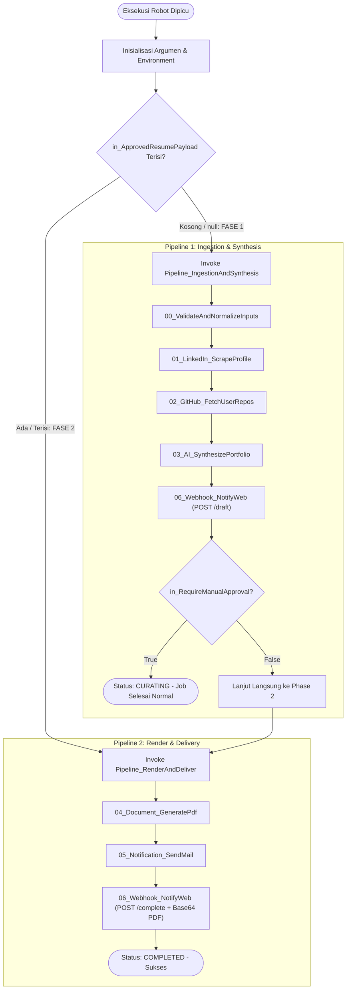

# Arsitektur Sistem & Spesifikasi Modul UiPath

> **AutoCV-Robot Technical Architecture Dossier**  
> Standar Desain: Clean Architecture, Single Responsibility Principle (SRP), Smart Dual-Mode Dispatching.

Dokumen ini menguraikan secara komprehensif arsitektur internal robot RPA **AutoCV**, kontrak data masukan/keluaran, pemisahan tanggung jawab alur kerja (*workflows*), dan pola ketahanan (*fault-tolerance*) yang diterapkan pada level enterprise.

---

## 1. Arsitektur Smart Dual-Mode Dispatcher (`Main.xaml`)

Salah satu tantangan terbesar otomasi yang melibatkan persetujuan manusia (*Human-in-the-Loop*) adalah **pemborosan lisensi robot unattended** jika robot dibiarkan dalam kondisi *wait/sleep* berjam-jam menunggu review pengguna.

AutoCV mengatasi masalah ini melalui **Smart Dual-Mode Dispatcher** di dalam [Main.xaml](../Main.xaml). Satu paket proses UiPath yang sama dapat menangani dua fase kerja independen berdasarkan ada atau tidaknya argumen `in_ApprovedResumePayload`:



### Keunggulan Desain Dual-Mode:
1. **Zero License Waste**: Robot Fase 1 selesai dalam hitungan detik setelah draf terkirim ke Web. Mesin VM unattended langsung bebas mengeksekusi job lain di Orchestrator queue.
2. **Deterministic Triggering**: Ketika pengguna menekan tombol *Approve & Generate* di Web Portal, Web API memanggil UiPath Orchestrator untuk menjalankan job Fase 2 dengan menyertakan payload kurasi pada `in_ApprovedResumePayload`.
3. **Single Process Deployment**: Tim DevOps hanya perlu mendaftarkan 1 Process Key (`AutoCV`) di Orchestrator Folder tanpa perlu memelihara dua proses terpisah.

---

## 2. Rincian Pipeline Orkestrasi (`Modules/Pipelines/`)

Untuk memenuhi prinsip *Clean Code* dan *Single Responsibility Principle (SRP)*, logika alur kerja dipecah dari `Main.xaml` menjadi dua pipeline terisolasi:

### 2.1 [Pipeline_IngestionAndSynthesis.xaml](../Modules/Pipelines/Pipeline_IngestionAndSynthesis.xaml)
- **Tanggung Jawab**: Mengorkestrasi ekstraksi data eksternal, sintesis AI, dan notifikasi draf awal ke Web Portal.
- **Urutan Langkah**:
  1. Validasi format URL LinkedIn, GitHub, dan target role (`00_ValidateAndNormalizeInputs`).
  2. Scraping riwayat kerja dari LinkedIn (`01_LinkedIn_ScrapeProfile`).
  3. Fetch repositori publik dan metadata dari GitHub (`02_GitHub_FetchUserRepos`).
  4. Sintesis data portofolio menggunakan LLM dengan formula STAR/XYZ (`03_AI_SynthesizePortfolio`).
  5. Kirim payload draf ke backend via Webhook `/draft` (`06_Webhook_NotifyWeb`).
- **Keluaran**: `out_DraftResumePayload` (JSON String).

### 2.2 [Pipeline_RenderAndDeliver.xaml](../Modules/Pipelines/Pipeline_RenderAndDeliver.xaml)
- **Tanggung Jawab**: Mengorkestrasi kompilasi dokumen ATS, pengiriman email hasil, dan notifikasi akhir.
- **Urutan Langkah**:
  1. Parsing dan validasi payload hasil kurasi manusia (`in_ApprovedResumePayload`).
  2. Panggil engine generator dokumen untuk memproduksi file DOCX dan PDF ATS (`04_Document_GeneratePdf`).
  3. Kirim email berisi lampiran resume ke kandidat (`05_Notification_SendMail`).
  4. Kirim webhook `/complete` dengan lampiran Base64 PDF ke Web Portal (`06_Webhook_NotifyWeb`).
- **Keluaran**: `out_GeneratedPdfPath`, `out_GeneratedDocxPath`, `out_EmailSentStatus`.

---

## 3. Spesifikasi Rinci Modul Fitur (`Modules/*`)

Seluruh modul ditempatkan dalam paket fitur mandiri dengan parameter yang jelas:

### Modul 00: [Validation/00_ValidateAndNormalizeInputs.xaml](../Modules/Validation/00_ValidateAndNormalizeInputs.xaml)
- **Fungsi**: Memastikan integritas masukan URL dan email menggunakan pola Regex.
- **Input Arguments**: `in_LinkedInUrl`, `in_GitHubUrl`, `in_TargetJobRole`, `in_RecipientEmail`.
- **Output Arguments**: `out_NormalizedLinkedInUrl`, `out_NormalizedGitHubUrl`, `out_NormalizedRole`, `out_NormalizedEmail`.
- **Resilience**: Mengoreksi trailing slash, menghapus prefix URL redundan, dan menormalkan whitespace.

### Modul 01: [LinkedIn/01_LinkedIn_ScrapeProfile.xaml](../Modules/LinkedIn/01_LinkedIn_ScrapeProfile.xaml)
- **Fungsi**: Mengekstrak nama, headline, ringkasan, riwayat pengalaman, pendidikan, dan skills dari profil LinkedIn publik.
- **Teknologi**: *UiPath Modern UI Automation* + JavaScript DOM Extractor (`Data/Scripts/LinkedIn/LinkedInDomExtractor.js`).
- **Input Arguments**: `in_LinkedInUrl`, `in_BrowserType`, `in_UseMockFallback`.
- **Output Arguments**: `out_LinkedInDataJson` (JSON String).
- **Fallback**: Jika browser session belum login, otomatis membaca berkas mock [LinkedInProfileMock.json](../Data/Mocks/LinkedInProfileMock.json) tanpa menggagalkan eksekusi.

### Modul 02: [GitHub/02_GitHub_FetchUserRepos.xaml](../Modules/GitHub/02_GitHub_FetchUserRepos.xaml)
- **Fungsi**: Mengambil profil GitHub, daftar repositori publik, bintang (*stars*), fork, bahasa pemrograman, dan topik.
- **Teknologi**: PowerShell Runner (`RunGitHubFetch.ps1`) memanggil skrip Node.js (`FetchGitHubRepos.js`).
- **Input Arguments**: `in_GitHubUrl`, `in_UseMockFallback`.
- **Output Arguments**: `out_GitHubReposJson` (JSON String).
- **Fallback**: Menggunakan fixture [GitHubReposMock.json](../Data/Mocks/GitHubReposMock.json) jika GitHub rate-limit atau akun offline.

### Modul 03: [AI/03_AI_SynthesizePortfolio.xaml](../Modules/AI/03_AI_SynthesizePortfolio.xaml)
- **Fungsi**: Menggabungkan data mentah LinkedIn dan GitHub menjadi draf resume berstandar industri dengan formula pencapaian STAR (*Situation, Task, Action, Result*) dan Google XYZ formula (*Accomplished [X] as measured by [Y], by doing [Z]*).
- **Teknologi**: `NetHttpRequest` dari paket `UiPath.WebAPI.Activities`.
- **Providers**: Google Gemini (`gemini-2.0-flash` / `gemini-3.5-flash-lite`) $\rightarrow$ fallback otomatis ke OpenRouter (`gpt-4o-mini`).
- **Input Arguments**: `in_LinkedInDataJson`, `in_GitHubReposJson`, `in_TargetJobRole`, `in_CandidateName`, `in_CandidateEmail`, `in_UseMockFallback`.
- **Output Arguments**: `out_DraftResumePayload` (JSON String).

### Modul 04: [Document/04_Document_GeneratePdf.xaml](../Modules/Document/04_Document_GeneratePdf.xaml)
- **Fungsi**: Mengonversi payload kurasi resume menjadi dokumen resmi DOCX (OpenXML) dan PDF ATS-friendly.
- **Teknologi**: PowerShell Runner (`RunResumeGeneration.ps1`) $\rightarrow$ `GenerateResumeDocument.js`.
- **Engine**: Native OpenXML Packager + Headless Chromium PDF Export.
- **Input Arguments**: `in_CuratedResumeJson`, `in_OutputFolder`.
- **Output Arguments**: `out_GeneratedPdfPath`, `out_GeneratedDocxPath`.

### Modul 05: [Notification/05_Notification_SendMail.xaml](../Modules/Notification/05_Notification_SendMail.xaml)
- **Fungsi**: Mengirimkan email hasil akhir kepada kandidat dengan lampiran dokumen PDF resume.
- **Teknologi**: PowerShell Runner (`SendEmailNotification.ps1`) mendukung mode SMTP asli maupun mode SIMULATION (aman tanpa kredensial rahasia).
- **Input Arguments**: `in_RecipientEmail`, `in_CandidateName`, `in_PdfAttachmentPath`, `in_SmtpServer`, `in_SmtpPort`, `in_SmtpUsername`, `in_SmtpPassword`.
- **Output Arguments**: `out_EmailSent` (Boolean), `out_EmailStatusMessage` (String).

### Modul 06: [Webhook/06_Webhook_NotifyWeb.xaml](../Modules/Webhook/06_Webhook_NotifyWeb.xaml)
- **Fungsi**: Melakukan panggilan REST API dua arah kembali ke Web Portal untuk memperbarui status job (`/draft`, `/progress`, `/complete`, `/error`).
- **Teknologi**: `NetHttpRequest` (`UiPath.WebAPI.Activities`).
- **Input Arguments**: `in_WebhookBaseUrl`, `in_JobId`, `in_EventType`, `in_PayloadJson`, `in_PdfPath`.
- **Output Arguments**: `out_ResponseStatusCode`, `out_ResponseContent`.

---

## 4. Dynamic Path Resolution Pattern (`PathUtils.ps1`)

Salah satu kendala umum pada proyek RPA multi-bahasa (UiPath + PowerShell + Node.js) adalah kerapuhan path relatif ketika file dipindahkan ke dalam sub-folder. 

AutoCV menerapkan pola terpusat pada [Data/Scripts/Shared/PathUtils.ps1](../Data/Scripts/Shared/PathUtils.ps1) menggunakan fungsi `Get-RobotContext`:

```powershell
function Get-RobotContext {
    param([string]$CallerDir)
    
    # Menelusuri direktori ke atas secara dinamis hingga menemukan project.json
    $current = $CallerDir
    while (-not [string]::IsNullOrWhiteSpace($current)) {
        if (Test-Path (Join-Path $current "project.json")) {
            return @{
                RobotRoot = $current
                DataDir   = Join-Path $current "Data"
                OutputsDir= Join-Path $current "Data\Outputs"
                ScriptsDir= Join-Path $current "Data\Scripts"
            }
        }
        $parent = Split-Path -Parent $current
        if ($parent -eq $current) { break }
        $current = $parent
    }
}
```

**Dampak Positif**: Seluruh skrip otomatis menemukan letak direktori root `robot/`, `Data/Outputs/`, dan `Data/Templates/` secara independen, tanpa pernah bergantung pada *hardcoded drive letter* (`C:\` atau `D:\`) maupun kedalaman folder relatif (`..\..`).

---

## 5. Standar Naming Convention, Variable Scoping & Anotasi UiPath

AutoCV menerapkan standar industri pengembangan UiPath (sejalan dengan *UiPath Official Best Practices* dan *Workflow Analyzer*):

### 5.1 Standar Penamaan Argumen & Variabel
Setiap argumen dan variabel memiliki prefix tipe data dan arah aliran:

| Kategori | Prefix Standar | Contoh Nyata di Proyek | Keterangan |
|---|---|---|---|
| **In Argument** | `in_` atau `in_str_`, `in_bool_` | `in_JobId`, `in_LinkedInUrl`, `in_UseMockFallback` | Data masukan ke dalam workflow |
| **Out Argument** | `out_` atau `out_str_`, `out_bool_` | `out_GeneratedPdfPath`, `out_DraftResumePayload` | Nilai hasil luaran workflow |
| **InOut Argument** | `io_` | `io_ExecutionConfig` | Data yang dibaca dan dimutasi |
| **String Variable** | `str_` atau `str` | `strScrapedJsonRaw`, `strNormalizedEmail` | Teks dan payload JSON string |
| **Boolean Variable** | `bool_` atau `bool` | `boolIsJob2`, `boolExtractionSuccessful` | Kondisi logika True/False |
| **Integer Variable** | `int_` atau `int` | `intInjectJsTimeoutMs`, `intStatusCode` | Angka bulat / timeout |
| **DataTable / Object**| `dt_`, `obj_` | `dt_SkillsMatrix`, `objPayload` | Struktur data tabel atau generic object |

### 5.2 Aturan Variable Scoping (Prinsip Akses Minimum)
- **Scope Terbatas (Local Isolation)**: Variabel lokal dideklarasikan pada *Sequence* terkecil yang membutuhkannya, bukan ditarik ke root sequence workflow. Hal ini mencegah konflik penamaan (*variable shadowing*) dan kebocoran memori.
- **Argumen sebagai Jembatan Antar Modul**: Pertukaran data antar berkas XAML hanya diizinkan melalui *In/Out Arguments* yang terikat secara eksplisit pada aktivitas `InvokeWorkflowFile`.

### 5.3 Penamaan Sequence, Activity & Anotasi Visual
- **Penamaan Deskriptif**: Tidak ada sequence bernama `Sequence_1` atau activity bernama `Assign_2`. Semua aktivitas diberi nama operasional, misalnya: `Validate URL Formats`, `Inject Resilient Profile Scraper`, `Check Execution Phase Dual-Mode`.
- **Anotasi Visual (Annotation)**: Seluruh Sequence utama, blok `TryCatch`, dan kondisi percabangan `If` krusial dilengkapi anotasi visual (`sap2010:Annotation.AnnotationText`) untuk mempermudah Dewan Juri memahami maksud bisnis alur tanpa harus membuka panel *Properties*.

---

## 6. Alasan Pemilihan Aktivitas Tertentu (Activity Selection Rationale)

Setiap aktivitas UiPath dipilih dengan pertimbangan teknis matang:

1. **`Use Application/Browser` & `InjectJsScript` (Modul LinkedIn)**:
   - *Alasan*: Halaman profil LinkedIn adalah *Single Page Application (SPA)* berbasis React dengan class CSS dinamis yang sering berubah. Selektor visual standar sangat rapuh (*flaky*). Dengan menginjeksikan skrip JavaScript DOM extractor langsung ke konteks halaman, ekstraksi data menjadi deterministik, tahan terhadap pembaruan antarmuka LinkedIn, dan tidak memicu deteksi bot agresif.
2. **`NetHttpRequest` / `HttpClient` (Modul GenAI & Webhook)**:
   - *Alasan*: Menghubungi REST API Google Gemini dan backend Webhook secara langsung tanpa ketergantungan pada *UiPath GenAI Activities* (yang membutuhkan lisensi tenant komersial khusus dan konfigurasi AI Trust Layer). Pendekatan ini mandiri, portabel, dan langsung bisa dijalankan di lingkungan pengujian manapun.
3. **`Invoke PowerShell` & Node.js Engine (Modul Dokumen & GitHub)**:
   - *Alasan*: Membangun dokumen WordprocessingML (.docx) dan PDF ATS berkecepatan tinggi (< 1.5 detik) tanpa memerlukan instalasi Microsoft Office Word di mesin virtual (*Zero MS Office License*), serta memanfaatkan browser Chromium headless (Edge/Chrome bawaan Windows) yang selalu tersedia di setiap PC.
4. **`InvokeWorkflowFile` (Main Dispatcher & Pipelines)**:
   - *Alasan*: Menjaga isolasi tanggung jawab (*Single Responsibility Principle*). Jalur file menggunakan relative path ke root robot (`Modules\Pipelines\...`) yang divalidasi otomatis oleh compiler UiPath.

