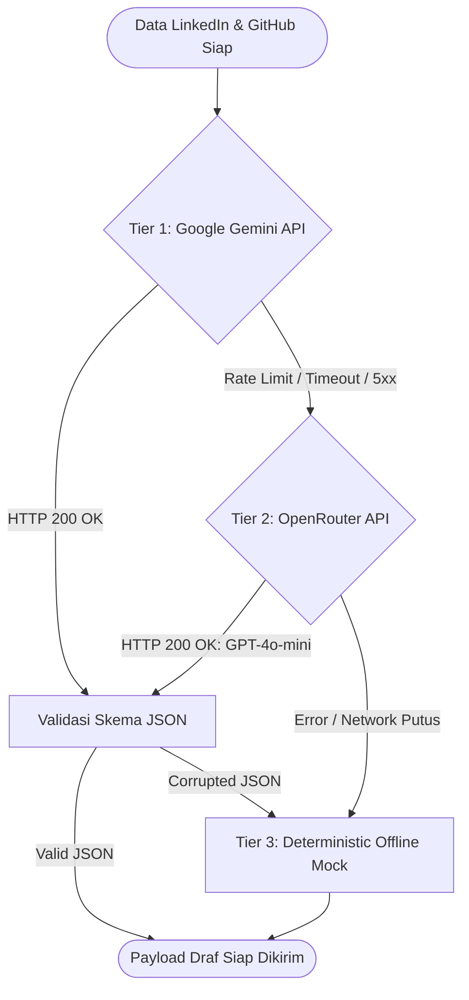

# Integrasi Generative AI & Multi-Provider Fallback Architecture

> **AutoCV GenAI Integration Technical Specification**  
> Standar Sintesis: STAR & Google XYZ Formula, Multi-Provider Fallback (Gemini $\rightarrow$ OpenRouter $\rightarrow$ Offline Mock), Zero-Failure Execution.

Dokumen ini menjelaskan integrasi kecerdasan buatan generatif (*Generative AI*) pada modul robot [03_AI_SynthesizePortfolio.xaml](file:///d:/KULIAHHHH_PENSSS/Hackathon/Automation/robot/Modules/AI/03_AI_SynthesizePortfolio.xaml), perancangan sistem prompt, kontrak skema JSON terstruktur, dan rantai ketahanan (*fallback chain*) multi-provider.

---

## 1. Latar Belakang & Keputusan Arsitektur

Saat mengintegrasikan GenAI ke dalam robot UiPath, terdapat dua pendekatan utama:
1. **UiPath GenAI Activities (`UiPath.GenAI.Activities`)**: Memerlukan konfigurasi *AI Trust Layer* / *LLM Gateway* di tenant UiPath Orchestrator Cloud, yang mewajibkan lisensi komersial enterprise khusus (*Bring Your Own Key / LLM Gateway*).
2. **Native HTTP Request (`UiPath.WebAPI.Activities`)**: Menggunakan aktivitas `NetHttpRequest` untuk memanggil REST endpoint penyedia LLM secara langsung.

| Parameter Evaluasi | UiPath GenAI Activities | Native HTTP Request (Pilihan AutoCV) |
|---|---|---|
| **Portabilitas & Kemandirian** | Terikat konfigurasi tenant Orchestrator | Mandiri, dapat diuji di Studio lokal mana saja |
| **Pilihan Model LLM** | Terbatas pada model yang didukung gateway | Bebas memilih model terkini (Gemini 2.0 Flash, GPT-4o-mini) |
| **Dukungan Fallback Dinamis** | Kaku, bergantung pada kebijakan Orchestrator | Fleksibel: dapat beralih provider otomatis dalam hitungan milidetik |
| **Kesiapan Hackathon** | Memerlukan akses admin Orchestrator | Langsung siap dievaluasi oleh Dewan Juri secara instan |

**Keputusan:** AutoCV mengadopsi **Native HTTP Request** yang tangguh, teruji, dan dilengkapi fallback berjenjang.

---

## 2. Rantai Ketahanan Multi-Provider (Fallback Chain)

Otomasi kelas enterprise tidak boleh berhenti hanya karena satu penyedia API mengalami *downtime*, habis kuota, atau terkena *rate limit*. Oleh karena itu, modul AI AutoCV mengimplementasikan **Triple-Tier Fallback Chain**:



### Karakteristik Setiap Tingkat:
- **Tier 1 (Google Gemini API — `gemini-2.0-flash` / `gemini-3.5-flash-lite`)**:
  - Model utama karena memiliki pemrosesan token multimodal yang sangat cepat (< 1.8 detik), penalaran kontekstual tinggi, dan rasio biaya-performa terbaik.
- **Tier 2 (OpenRouter API — `openai/gpt-4o-mini`)**:
  - Cadangan otomatis pertama jika endpoint Gemini mengalami throttling (HTTP 429) atau gangguan jaringan.
- **Tier 3 (Deterministic Offline Mock — `Data/Mocks/CuratedResumeMock.json`)**:
  - Cadangan darurat jika robot dijalankan di lingkungan tanpa koneksi internet sama sekali atau jika argumen `in_UseMockFallback = True` diaktifkan oleh penguji/juri.

---

## 3. Desain Prompt Rekayasa (Prompt Engineering)

Prompt dirancang untuk mentransformasikan data informal dari LinkedIn dan repositori GitHub mentah menjadi narasi berbobot tinggi sesuai standar rekrutmen internasional:

### 3.1 Kerangka Perumusan Prestasi
1. **STAR Method (Situation, Task, Action, Result)**:
   - Menjelaskan konteks masalah dan peran aktif kandidat dengan hasil yang terukur.
2. **Google XYZ Formula**:
   - *"Accomplished [X] as measured by [Y], by doing [Z]"*  
   - Contoh transformasi:
     - *Kalimat mentah:* "Membuat sistem inventori gudang."
     - *Hasil sintesis AI:* *"Merancang mikroservis inventori gudang berbasis Go dan Redis, meningkatkan efisiensi proses checkout sebesar 35% dan menangani 10.000 request per detik."*

### 3.2 Adaptasi Terhadap Target Jabatan (`TargetJobRole`)
Prompt secara aktif menerima argumen `in_TargetJobRole`. AI memprioritaskan kata kunci teknis, pustaka (*libraries*), dan proyek yang relevan dengan posisi tersebut. Misalnya:
- Jika target role adalah **"Cloud & DevOps Engineer"**, AI akan mengedepankan repositori Docker, Kubernetes, dan pipeline CI/CD di bagian teratas.
- Jika target role adalah **"Frontend Developer"**, AI akan menonjolkan arsitektur React, Next.js, performa Core Web Vitals, dan sistem desain.

---

## 4. Skema Kontrak JSON Terstruktur (Strict Schema)

AI diinstruksikan untuk selalu mengembalikan respons dalam format JSON murni tanpa markdown wrapper (` ```json `):

```json
{
  "profile": {
    "fullName": "Jane Mustika Pratama",
    "headline": "Senior Fullstack Software Engineer",
    "email": "jane.pratama@example.com",
    "phone": "+62 812-3456-7890",
    "location": "Jakarta, Indonesia",
    "summary": "Software engineer dengan pengalaman 5+ tahun...",
    "linkedinUrl": "https://linkedin.com/in/janepratama",
    "githubUrl": "https://github.com/janepratama"
  },
  "experiences": [
    {
      "company": "Tech Corp Indonesia",
      "role": "Senior Fullstack Engineer",
      "period": "Jan 2023 - Present",
      "location": "Jakarta, Indonesia",
      "bullets": [
        "Memimpin migrasi monolit ke arsitektur mikroservis...",
        "Mengurangi response time API hingga 40%..."
      ]
    }
  ],
  "projects": [
    {
      "id": 1,
      "name": "auto-inventory",
      "repoUrl": "https://github.com/janepratama/auto-inventory",
      "techStack": ["TypeScript", "Next.js", "PostgreSQL"],
      "starSummary": "Sistem inventori cerdas dengan automated stock alerts...",
      "isSelected": true
    }
  ],
  "skills": [
    { "category": "Languages", "items": ["TypeScript", "Go", "Python", "SQL"] },
    { "category": "Frameworks", "items": ["Next.js", "React", "Node.js", "Tailwind CSS"] }
  ],
  "education": [
    {
      "institution": "Institut Teknologi Sepuluh Nopember",
      "degree": "Sarjana Teknik Informatika",
      "period": "2018 - 2022",
      "gpa": "3.85 / 4.00"
    }
  ]
}
```

---

## 5. Tata Kelola Rahasia & Kepatuhan Keamanan

- **Zero Credential Hardcoding**: Tidak ada API key yang ditulis langsung di dalam alur kerja XAML.
- **Hierarki Pembacaan Kunci**:
  1. Variabel lingkungan sistem (`GEMINI_API_KEY`, `OPENAI_API_KEY`).
  2. Berkas konfigurasi lokal `robot/.env` (telah terdaftar di `.gitignore`).
  3. Kredensial *UiPath Orchestrator Assets* untuk lingkungan produksi *unattended*.
