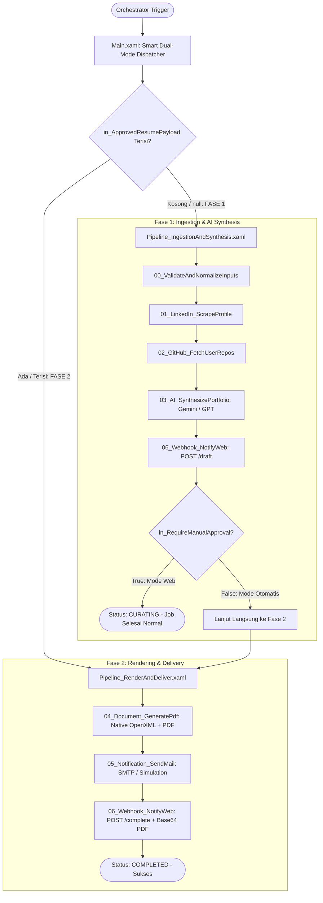

# AutoCV-Robot — Intelligent Career Dossier & ATS Resume Builder

> **Solusi Otomasi RPA & Generative AI untuk Transformasi Karir Berbasis Standar ATS Internasional**  
> **Automation Hackathon 2026** · *Indosat Ooredoo Hutchison × UiPath × ONE Indonesia*  
> Tema Utama: **#HumanInTheLead** · Kategori: Enterprise RPA & GenAI Integration

[](https://www.uipath.com/)
[](https://dotnet.microsoft.com/)
[](https://ai.google.dev/)
[](#2-arsitektur-smart-dual-mode-dispatcher)
[-brightgreen.svg)](#3-quickstart-evaluasi-juri-5-minute-review)
[](#3-quickstart-evaluasi-juri-5-minute-review)
[](LICENSE)

---

## 1. Executive Summary & Value Proposition

Dalam ekosistem rekrutmen modern, lebih dari **75% resume pelamar gugur di tahap screening awal Applicant Tracking System (ATS)** sebelum sempat dibaca oleh rekruter manusia. Kegagalan ini sebagian besar bukan disebabkan oleh kurangnya kualifikasi kandidat, melainkan format dokumen non-standar (multi-kolom, tabel rumit, ikon grafis) dan narasi pengalaman yang pasif.

**AutoCV-Robot** hadir sebagai mesin otomasi enterprise yang mentransformasikan data profesional mentah (profil publik LinkedIn dan repositori kode GitHub) menjadi **Career Dossier berstandar Harvard & Stanford ATS** dengan rumusan pencapaian berbasis **STAR** (*Situation, Task, Action, Result*) dan **Google XYZ Formula**.

### Filosofi #HumanInTheLead
Berbeda dengan sistem AI tertutup yang langsung mengirimkan output tanpa pengawasan, AutoCV menempatkan manusia sebagai pengambil keputusan akhir (*Human-in-the-Loop*):
1. **Robot Job 1**: Mengekstrak data dan menyintesis draf awal dengan GenAI dalam hitungan detik.
2. **Kandidat (Manusia)**: Menginspeksi, mengedit butir pengalaman, memilih proyek unggulan, dan menyetujui hasil kurasi pada Web Portal.
3. **Robot Job 2**: Mengompilasi dokumen resmi OpenXML (.docx) dan PDF ATS beresolusi tinggi, lalu mengirimkannya via email.

---

## 2. Arsitektur Smart Dual-Mode Dispatcher

AutoCV mengimplementasikan pola **Smart Dual-Mode Dispatcher** di dalam [Main.xaml](file:///d:/KULIAHHHH_PENSSS/Hackathon/Automation/robot/Main.xaml). Pola ini memecahkan masalah pemborosan lisensi *unattended robot*—robot Fase 1 tidak pernah dibiarkan dalam kondisi *wait/sleep* menunggu persetujuan manusia:



---

## 3. Quickstart Evaluasi Juri (5-Minute Review)

Dewan Juri dapat memverifikasi keandalan teknis robot secara langsung dari terminal PowerShell di folder [robot/](file:///d:/KULIAHHHH_PENSSS/Hackathon/Automation/robot) tanpa memerlukan kredensial eksternal:

### 1. Validasi Integritas 16 File XAML (100% Valid XML)
```powershell
powershell -ExecutionPolicy Bypass -File Data\Scripts\Shared\ValidateAllXaml.ps1
```
*Memvalidasi seluruh file XAML (Main, Pipelines, Modules, Tests) memiliki struktur XML yang benar dan siap dieksekusi Studio.*

### 2. Eksekusi Unit Test Suite (13/13 Green Test)
```powershell
node Data\Scripts\test_modules.js
```
*Menguji normalizer, OpenXML builder, HTML template ATS, browser locator, dan GitHub parser.*

### 3. Pembuatan Dokumen Resume ATS Nyata (End-to-End)
```powershell
powershell -ExecutionPolicy Bypass -File Data\Scripts\Document\RunResumeGeneration.ps1 -PayloadFile "Data\Mocks\CuratedResumeMock.json"
```
*Menghasilkan dokumen resmi `.docx` dan `.pdf` ATS dalam waktu < 1.5 detik di folder [Data/Outputs/](file:///d:/KULIAHHHH_PENSSS/Hackathon/Automation/robot/Data/Outputs).*

### 4. Uji Pengambilan Portofolio GitHub (Live & Fallback)
```powershell
powershell -ExecutionPolicy Bypass -File Data\Scripts\GitHub\RunGitHubFetch.ps1 -GitHubInput "octocat" -UseMockFallback "true"
```
*Menguji integrasi API publik GitHub dengan ketahanan fallback otomatis.*

> Panduan evaluasi lengkap untuk Dewan Juri tersedia di: [Docs/Jury-Evaluation-Guide.md](file:///d:/KULIAHHHH_PENSSS/Hackathon/Automation/robot/Docs/Jury-Evaluation-Guide.md).

---

## 4. Struktur Repository Modular Baru

Seluruh alur kerja telah dipecah mengikuti *Single Responsibility Principle (SRP)* ke dalam paket fitur terorganisasi:

```text
robot/
├── Main.xaml                                       # Lightweight Dispatcher / Router (~140 baris)
├── project.json                                    # UiPath Project Manifest (.NET 10, Windows)
│
├── Modules/                                        # Modul Alur Kerja UiPath
│   ├── Pipelines/                                  # Pipeline Orkestrasi Utama
│   │   ├── Pipeline_IngestionAndSynthesis.xaml     # Orkestrasi Fase 1 (Ingestion & AI)
│   │   └── Pipeline_RenderAndDeliver.xaml          # Orkestrasi Fase 2 (Render & Email)
│   ├── Validation/
│   │   └── 00_ValidateAndNormalizeInputs.xaml      # Sanitasi regex input URL & email
│   ├── LinkedIn/
│   │   └── 01_LinkedIn_ScrapeProfile.xaml          # Scraping profil LinkedIn publik
│   ├── GitHub/
│   │   └── 02_GitHub_FetchUserRepos.xaml           # Fetch repositori & statistik GitHub
│   ├── AI/
│   │   └── 03_AI_SynthesizePortfolio.xaml          # Multi-LLM synthesis (Gemini/OpenRouter)
│   ├── Document/
│   │   └── 04_Document_GeneratePdf.xaml            # Pembuatan dokumen DOCX & PDF ATS
│   ├── Notification/
│   │   └── 05_Notification_SendMail.xaml           # Pengiriman email hasil ke kandidat
│   └── Webhook/
│       └── 06_Webhook_NotifyWeb.xaml               # Komunikasi REST API 2-arah ke Web
│
├── Data/
│   ├── Config/                                     # Konfigurasi AI & Lingkungan (.env lokal)
│   ├── Mocks/                                      # Fixture deterministik untuk pengujian offline
│   │   ├── CuratedResumeMock.json                  # Mock payload kurasi manusia
│   │   ├── GitHubReposMock.json                    # Mock data repositori GitHub
│   │   └── LinkedInProfileMock.json                # Mock data profil LinkedIn
│   ├── Outputs/                                    # Direktori output berkas PDF/DOCX
│   │   └── .gitkeep
│   ├── Templates/                                  # Template DOCX berstandar ATS
│   │   └── ATS_Resume_Template.docx
│   └── Scripts/                                    # Automation Engine & Helper Scripts
│       ├── Shared/
│       │   ├── PathUtils.ps1                       # Dynamic robot context & path resolver (DRY)
│       │   └── ValidateAllXaml.ps1                 # Validasi XML syntax seluruh XAML
│       ├── LinkedIn/
│       │   └── LinkedInDomExtractor.js             # JavaScript DOM extraction script
│       ├── GitHub/
│       │   ├── FetchGitHubRepos.js                 # Node.js GitHub API fetcher
│       │   └── RunGitHubFetch.ps1                  # PowerShell runner GitHub
│       ├── Document/
│       │   ├── GenerateResumeDocument.js           # Core document generator orchestrator
│       │   ├── RunResumeGeneration.ps1             # PowerShell runner resume generation
│       │   ├── GenerateAtsTemplate.ps1             # Generator template OpenXML
│       │   └── lib/                                # OpenXML & PDF Engine Libraries
│       │       ├── docxPackager.js                 # ZIP & OpenXML packager
│       │       ├── htmlTemplate.js                 # ATS single-column HTML template
│       │       ├── normalizer.js                   # XML escaping & noise sanitizer
│       │       ├── openXmlBuilder.js               # WordprocessingML builder
│       │       └── pdfExporter.js                  # Chrome/Edge headless PDF exporter
│       ├── Notification/
│       │   └── SendEmailNotification.ps1           # SMTP & Simulation email runner
│       ├── Webhook/
│       │   └── SendWebhookNotification.ps1         # Webhook dispatcher script
│       └── test_modules.js                         # Automated unit test suite (13 tests)
│
├── Tests/                                          # Unit Tests UiPath per Modul
│   ├── Validation/Test_Validate_Inputs.xaml
│   ├── LinkedIn/Test_LinkedIn_Scraper.xaml
│   ├── GitHub/Test_GitHub_FetchRepos.xaml
│   ├── Document/Test_Document_GeneratePdf.xaml
│   ├── Notification/Test_Notification_SendMail.xaml
│   └── Webhook/Test_Webhook_NotifyWeb.xaml
│
└── Docs/                                           # Dokumentasi Teknis Lengkap
    ├── Jury-Evaluation-Guide.md                    # Panduan evaluasi juri 5 menit
    ├── Architecture-and-Workflows.md               # Arsitektur & spesifikasi modul detail
    ├── Document-Engine-Technical-Spec.md           # Spesifikasi engine OpenXML & PDF ATS
    ├── GenAI-Integration.md                        # Integrasi GenAI & multi-provider fallback
    └── AutomationHub-URL-Decision.md               # Keputusan tata kelola Automation Hub
```

---

## 5. Matriks Ketahanan Sistem (Multi-Layer Resilience)

AutoCV dirancang dengan prinsip **Zero Break**: robot tidak boleh berhenti di tengah jalan hanya karena faktor eksternal:

| Titik Potensi Kegagalan | Mekanisme Ketahanan (Fallback) AutoCV | Status / Hasil |
|---|---|---|
| **Sesi LinkedIn Belum Login di VM** | Mendeteksi ketiadaan sesi browser dan otomatis beralih ke [LinkedInProfileMock.json](file:///d:/KULIAHHHH_PENSSS/Hackathon/Automation/robot/Data/Mocks/LinkedInProfileMock.json). | Proses berlanjut mulus tanpa exception. |
| **GitHub API Rate Limit / Offline** | Menangkap HTTP error 403/timeout dan beralih ke [GitHubReposMock.json](file:///d:/KULIAHHHH_PENSSS/Hackathon/Automation/robot/Data/Mocks/GitHubReposMock.json). | Portofolio tetap tersintesis sempurna. |
| **Gemini API Limit / Kuota Habis** | Otomatis beralih ke Tier 2: OpenRouter (`gpt-4o-mini`), lalu ke Tier 3: Sintesis deterministik lokal. | Draf resume selalu berhasil dibuat. |
| **Tidak Ada Microsoft Office Word** | Engine menggunakan **Native OpenXML Builder** (WordprocessingML) dan mencetak PDF via **Headless Chromium bawaan Windows (Edge/Chrome)**. | Zero lisensi berbayar, waktu cetak < 1.5 detik. |
| **Kredensial SMTP Email Kosong** | Otomatis mengaktifkan `Mode: SIMULATION`, mencatat log pengiriman, dan tetap memproses webhook `/complete`. | Job Orchestrator selalu berstatus *Success*. |

---

## 6. Kontrak Argumen Robot (`Main.xaml`)

| Argumen | Tipe | Arah | Default | Deskripsi |
|---|---|---|---|---|
| `in_JobId` | String | In | `"job-local-001"` | ID unik pekerjaan dari Web Portal. |
| `in_LinkedInUrl` | String | In | `""` | URL profil publik LinkedIn kandidat. |
| `in_GitHubUrl` | String | In | `""` | URL profil atau username GitHub kandidat. |
| `in_TargetJobRole` | String | In | `"Software Engineer"` | Target posisi kerja untuk pembobotan kata kunci AI. |
| `in_RecipientEmail` | String | In | `""` | Email tujuan pengiriman resume final. |
| `in_UseMockFallback` | Boolean | In | `True` | Mengaktifkan mock fallback jika sumber eksternal offline. |
| `in_RequireManualApproval` | Boolean | In | `True` | Menahan alur pada status `CURATING` menunggu persetujuan web. |
| `in_WebhookBaseUrl` | String | In | `"http://localhost:3000"` | URL endpoint backend Web Portal. |
| `in_ApprovedResumePayload` | String | In | `""` | **Kunci Dual-Mode**: Jika terisi, robot langsung menjalankan Fase 2. |
| `out_GeneratedPdfPath` | String | Out | — | Lokasi absolut berkas PDF hasil kompilasi. |
| `out_GeneratedDocxPath` | String | Out | — | Lokasi absolut berkas DOCX hasil kompilasi. |
| `out_DraftResumePayload` | String | Out | — | Objek JSON draf hasil sintesis AI (Fase 1). |
| `out_EmailSentStatus` | String | Out | — | Status akhir pengiriman email (`SENT` atau `SIMULATION`). |

---

## 7. Keamanan & Tata Kelola Secrets

Proyek ini menerapkan standar keamanan enterprise ketat:
- **Zero Secrets in Code**: Tidak ada API key, token GitHub, maupun kata sandi SMTP yang di-hardcode di dalam berkas XAML atau skrip.
- **Penyimpanan Lokal Aman**: Seluruh rahasia pengujian lokal disimpan dalam `.env` atau `Data/Config/ai_settings.json` yang secara otomatis diabaikan oleh [.gitignore](file:///d:/KULIAHHHH_PENSSS/Hackathon/Automation/robot/.gitignore).
- **Kesiapan Produksi**: Pada lingkungan produksi, konfigurasi dibaca langsung dari **UiPath Orchestrator Assets** (tipe *Credential* & *Text*).

---

## 8. Indeks Dokumentasi Teknis Lengkap

Untuk eksplorasi teknis lebih mendalam, silakan merujuk pada dokumen berikut:

| Dokumen | Deskripsi |
|---|---|
| [Docs/Jury-Evaluation-Guide.md](file:///d:/KULIAHHHH_PENSSS/Hackathon/Automation/robot/Docs/Jury-Evaluation-Guide.md) | **Panduan Evaluasi Juri 5 Menit**: Perintah pengujian 1-baris, verifikasi kriteria hackathon, dan checklist penilaian. |
| [Docs/Architecture-and-Workflows.md](file:///d:/KULIAHHHH_PENSSS/Hackathon/Automation/robot/Docs/Architecture-and-Workflows.md) | **Arsitektur Sistem & Spesifikasi Modul**: Rincian alur kerja Smart Dual-Mode, dekomposisi pipeline, dan kontrak modul. |
| [Docs/Document-Engine-Technical-Spec.md](file:///d:/KULIAHHHH_PENSSS/Hackathon/Automation/robot/Docs/Document-Engine-Technical-Spec.md) | **Spesifikasi Engine Dokumen ATS**: Standar Harvard/Stanford ATS, OpenXML WordprocessingML, dan PDF export. |
| [Docs/GenAI-Integration.md](file:///d:/KULIAHHHH_PENSSS/Hackathon/Automation/robot/Docs/GenAI-Integration.md) | **Integrasi GenAI & Multi-LLM**: Formula STAR/XYZ, skema ketat JSON, dan rantai fallback Gemini $\rightarrow$ OpenRouter $\rightarrow$ Mock. |
| [Docs/AutomationHub-URL-Decision.md](file:///d:/KULIAHHHH_PENSSS/Hackathon/Automation/robot/Docs/AutomationHub-URL-Decision.md) | **Keputusan Tata Kelola Automation Hub**: Penjelasan tata kelola dan konfigurasi `automationHubUrl` pada `project.json`. |

---

## 9. Lisensi & Hak Cipta

Didistribusikan di bawah Lisensi MIT. Dikembangkan khusus untuk **Automation Hackathon 2026 (#HumanInTheLead)** oleh tim AutoCV.
