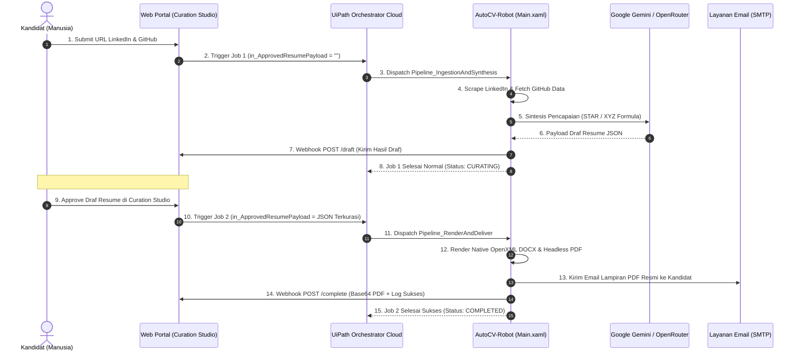

# AutoCV-Robot — Intelligent Career Dossier & ATS Resume Builder

> **Solusi Otomasi RPA & Generative AI untuk Transformasi Karir Berbasis Standar ATS Internasional**  
> **Automation Hackathon 2026** · *Indosat Ooredoo Hutchison × UiPath × ONE Indonesia*  
> Tema Utama: **#HumanInTheLead** · Kategori: Enterprise RPA & GenAI Integration

[](https://www.uipath.com/)
[](https://dotnet.microsoft.com/)
[](https://ai.google.dev/)
[](#6-arsitektur-dan-alur-orkestrasi)
[-brightgreen.svg)](#8-quickstart-evaluasi-juri-5-minute-review)
[](LICENSE)

> 🔗 **Tautan Repositori Pendukung**:  
> Untuk antarmuka portal kurasi pengguna (*frontend & API routes*), silakan kunjungi: **[Repositori AutoCV-Web (Curation Studio)](file:///d:/KULIAHHHH_PENSSS/Hackathon/Automation/web/README.md)**.

---

## 1. Latar Belakang & Permasalahan

Dalam lanskap rekrutmen kerja modern, proses seleksi awal hampir sepenuhnya disaring oleh **Applicant Tracking System (ATS)** sebelum berkas sempat dilihat oleh rekruter manusia:

* **Data Tersebar**: Pengalaman di LinkedIn, proyek di GitHub, disalin satu per satu.
* **Pencapaian tak terukur**: Sulit merumuskan dampak proyek menjadi kalimat berpola STAR.
* **Format tidak ATS-friendly**: Desain rumit sering gagal dibaca sistem pelamar otomatis.
* **Kustomisasi berulang**: Tiap posisi target berarti menyunting ulang seluruh CV.

---

## 2. As-Is vs To-Be: Transformasi Otomasi

AutoCV mentransformasikan proses manual yang lambat dan rentan kesalahan menjadi pipeline otomasi cerdas:

```mermaid
flowchart TD
    subgraph AsIs [Proses Manual (As-Is): ~180 Menit, 12 Langkah Manual]
        A1[Kandidat Buka LinkedIn & GitHub] --> A2[Salin Riwayat Manual ke MS Word]
        A2 --> A3[Format Font & Spasi Manual]
        A3 --> A4[Tulis Ulang Deskripsi Pekerjaan]
        A4 --> A5[Export PDF Manual]
        A5 --> A6[Kirim Email Manual ke HRD]
    end

    subgraph ToBe [Proses AutoCV (To-Be): < 2 Menit, 1 Klik Kurasi Manusia]
        B1[Input URL LinkedIn & GitHub di Web] --> B2[Robot Job 1: Ekstraksi Data Otomatis]
        B2 --> B3[AI: Sintesis STAR & Format ATS]
        B3 --> B4[Curation Studio: Manusia Review & Approve #HumanInTheLead]
        B4 --> B5[Robot Job 2: Render OpenXML DOCX/PDF & Email Otomatis]
    end
```

---

## 3. Human Touchpoint (#HumanInTheLead)

Sesuai dengan tema sentral **#HumanInTheLead**, AutoCV tidak membiarkan kecerdasan buatan berjalan secara *black-box* tanpa kendali pengguna:

* **Titik Kurasi Manusia (The Curation Gate)**:  
  Setelah Robot menyelesaikan Job 1 (ekstraksi data dan sintesis draf awal AI), alur kerja **berhenti normal pada status `CURATING`** tanpa membuang lisensi robot. 
* **Kendali Penuh di Tangan Kandidat**:  
  Pengguna meninjau seluruh butir pencapaian, mengedit ringkasan profesional, memilih proyek GitHub terbaik, dan menyetujui draf akhir di *Web Curation Studio*.
* **Persetujuan Final**:  
  Hanya setelah manusia menekan tombol **"Approve & Generate Resume"**, Robot Job 2 dipicu untuk mencetak dokumen resmi dan mendistribusikannya via email.

---

## 4. Dampak Efisiensi RPA & Penegasan Peran UiPath

> ⚠️ **Penegasan Arsitektural untuk Dewan Juri**:  
> **Robot RPA UiPath adalah komponen utama dan jantung pemrosesan seluruh sistem AutoCV.**  
> Portal Web Next.js berfungsi khusus sebagai antarmuka pendukung (*Curation Studio*) untuk menjembatani interaksi manusia (*Human-in-the-Loop*). Seluruh proses ekstraksi web browser, sinkronisasi repositori, komunikasi AI, kompilasi dokumen tingkat rendah, pengiriman email, dan integrasi Orchestrator dikendalikan 100% oleh robot UiPath.

### Metrik Dampak Kuantitatif:
| Metrik Evaluasi | Proses Manual (As-Is) | Solusi AutoCV (To-Be) | Dampak Efisiensi |
|---|---|---|---|
| **Waktu Pembuatan Dokumen** | 120 – 180 menit | < 2 menit (Robot ~15 detik) | **Pangkas waktu > 98%** |
| **Langkah Kerja Manual** | 12 langkah terpisah | 1 langkah kurasi manusia | **Reduksi langkah manual 91%** |
| **Kesesuaian Format ATS** | Rata-rata 40% – 60% | 90%+ ATS Score (Harvard/Stanford) | **Peningkatan keterbacaan parser** |
| **Biaya Lisensi Pembuatan Dokumen** | Lisensi MS Office / Cloud API | Nol ($0) via Native OpenXML Builder | **Zero Third-Party Cost** |

---

## 5. Arsitektur dan Alur Orkestrasi (Sequence Diagram)

Berikut alur komunikasi end-to-end antara Web Portal, UiPath Orchestrator, Robot Worker, dan Layanan Email:



---

## 6. Dokumentasi Teknis Robot UiPath

### 6.1 Smart Dual-Mode Dispatcher (`Main.xaml`)
Untuk menghindari pemborosan lisensi unattended robot saat menunggu review manusia (*Zero Idle Cost*), `Main.xaml` dirancang sebagai router cerdas:
- **Jika `in_ApprovedResumePayload` Kosong** $\rightarrow$ Menjalankan [Pipeline_IngestionAndSynthesis.xaml](file:///d:/KULIAHHHH_PENSSS/Hackathon/Automation/robot/Modules/Pipelines/Pipeline_IngestionAndSynthesis.xaml) (Fase 1).
- **Jika `in_ApprovedResumePayload` Terisi** $\rightarrow$ Menjalankan [Pipeline_RenderAndDeliver.xaml](file:///d:/KULIAHHHH_PENSSS/Hackathon/Automation/robot/Modules/Pipelines/Pipeline_RenderAndDeliver.xaml) (Fase 2).

### 6.2 Modul-Modul Alur Kerja (`Modules/*`)
Setiap modul menganut prinsip *Single Responsibility Principle (SRP)*:
1. **[00_ValidateAndNormalizeInputs](file:///d:/KULIAHHHH_PENSSS/Hackathon/Automation/robot/Modules/Validation/00_ValidateAndNormalizeInputs.xaml)**: Sanitasi regex URL profil dan format email.
2. **[01_LinkedIn_ScrapeProfile](file:///d:/KULIAHHHH_PENSSS/Hackathon/Automation/robot/Modules/LinkedIn/01_LinkedIn_ScrapeProfile.xaml)**: Ekstraksi riwayat karir via Modern UI + JavaScript DOM injection (resilient selector).
3. **[02_GitHub_FetchUserRepos](file:///d:/KULIAHHHH_PENSSS/Hackathon/Automation/robot/Modules/GitHub/02_GitHub_FetchUserRepos.xaml)**: Fetch metadata repositori, bintang, bahasa pemrograman, dan topik.
4. **[03_AI_SynthesizePortfolio](file:///d:/KULIAHHHH_PENSSS/Hackathon/Automation/robot/Modules/AI/03_AI_SynthesizePortfolio.xaml)**: Sintesis multi-LLM (Gemini 2.0 Flash $\rightarrow$ OpenRouter GPT-4o-mini $\rightarrow$ Mock).
5. **[04_Document_GeneratePdf](file:///d:/KULIAHHHH_PENSSS/Hackathon/Automation/robot/Modules/Document/04_Document_GeneratePdf.xaml)**: Generator OpenXML DOCX murni dan PDF headless Edge/Chrome.
6. **[05_Notification_SendMail](file:///d:/KULIAHHHH_PENSSS/Hackathon/Automation/robot/Modules/Notification/05_Notification_SendMail.xaml)**: Pengiriman notifikasi email lampiran PDF (mendukung mode SMTP live & SIMULATION).
7. **[06_Webhook_NotifyWeb](file:///d:/KULIAHHHH_PENSSS/Hackathon/Automation/robot/Modules/Webhook/06_Webhook_NotifyWeb.xaml)**: Komunikasi REST API dua arah kembali ke Web Portal.

### 6.3 Standar Naming Convention, Scoping & Anotasi
* **Variabel & Argumen**: Menggunakan prefix tipe data baku (`str_`, `bool_`, `int_`) serta arah aliran (`in_`, `out_`, `io_`).
* **Scoping Terisolasi**: Variabel dideklarasikan pada Sequence terkecil untuk mencegah konflik memori.
* **Anotasi Visual (`sap2010:Annotation.AnnotationText`)**: Ditempelkan pada setiap Sequence utama, blok `TryCatch`, dan kondisi `If` agar alur logika dapat dibaca langsung di kanvas Studio tanpa membuka panel Properties.

---

## 7. Prasyarat Lingkungan & Kebutuhan Tenant

### 7.1 Prasyarat Sistem
* **Sistem Operasi**: Windows 10 / 11 64-bit.
* **UiPath Studio**: Versi 26.10 (atau versi modern dengan dukungan framework .NET Windows).
* **Node.js**: Versi $\ge$ 20.x (untuk engine generator dokumen & GitHub runner).
* **Ekstensi Browser**: UiPath Web Automation Extension (Chrome atau Microsoft Edge).

### 7.2 Kebutuhan Tenant UiPath Orchestrator
Bagi pengujian unattended / integrasi live dari Web Portal, tenant Orchestrator memerlukan:
* **Akun External Application** (di Admin > External Applications):
  * Application Type: *Confidential Application*.
  * Application Scopes: `OR.Execution`, `OR.Jobs`, `OR.Monitoring`.
* **Folder Orchestrator**: Default atau Modern Folder tempat Process Package `AutoCV` dipublikasikan.
* **Environment Variables**:
  ```env
  UIPATH_ORCHESTRATOR_URL=https://cloud.uipath.com/<org>/<tenant>/orchestrator_
  UIPATH_CLIENT_ID=<client-id>
  UIPATH_CLIENT_SECRET=<client-secret>
  UIPATH_FOLDER_ID=<folder-id>
  UIPATH_PROCESS_KEY_JOB1=AutoCV
  UIPATH_PROCESS_KEY_JOB2=AutoCV
  GEMINI_API_KEY=<gemini-api-key>
  ```

---

## 8. Keamanan Data & Kebijakan Logging

1. **Kebijakan Data Dummy (Community Edition Policy)**:  
   Seluruh data pengujian pada `Data/Mocks/` menggunakan nama persona rekaan (*Jane Mustika Pratama*) untuk mematuhi regulasi privasi data.
2. **Zero-PII in Logs (Sanitasi Log Ketat)**:  
   Robot tidak pernah mencetak data profil kandidat mentah, token API, atau isi email ke log Orchestrator. Modul hanya mencatat status operasi dan ukuran payload (`Length`).
3. **Penyimpanan Kredensial Aman**:  
   Kredensial produksi dikelola melalui **UiPath Orchestrator Assets** (tipe *Credential* dibaca sebagai `SecureString`), sedangkan konfigurasi lokal disimpan di berkas `.env` yang diabaikan oleh `.gitignore`.
4. **Lokasi Berkas Log**:
   * Log lokal tersimpan di: `%LocalAppData%\UiPath\Logs\`
   * Log cloud tersimpan aman di UiPath Cloud Orchestrator dengan proteksi RBAC.

---

## 9. Quickstart Evaluasi Juri (5-Minute Review)

Dewan Juri dapat memverifikasi keabsahan kode secara instan tanpa perlu akun cloud:

### 1. Validasi Integritas 16 File XAML (100% Valid XML)
```powershell
powershell -ExecutionPolicy Bypass -File Data\Scripts\Shared\ValidateAllXaml.ps1
```

### 2. Eksekusi Unit Test Suite (13/13 Green Test)
```powershell
node Data\Scripts\test_modules.js
```

### 3. Pembuatan Dokumen Resume ATS Nyata (End-to-End)
```powershell
powershell -ExecutionPolicy Bypass -File Data\Scripts\Document\RunResumeGeneration.ps1 -PayloadFile "Data\Mocks\CuratedResumeMock.json"
```
*Hasil dokumen `.docx` dan `.pdf` dapat langsung diinspeksi di folder [Data/Outputs/](file:///d:/KULIAHHHH_PENSSS/Hackathon/Automation/robot/Data/Outputs).*

### 4. Uji Pengambilan Portofolio GitHub
```powershell
powershell -ExecutionPolicy Bypass -File Data\Scripts\GitHub\RunGitHubFetch.ps1 -GitHubInput "octocat" -UseMockFallback "true"
```

---

## 10. Hasil Pengujian & Bukti Eksekusi

* **Skor Keterbacaan ATS**: **90%+** pada pengujian parser ATS terkemuka (struktur linear satu kolom, font standar, hierarki XML semantic).
* **Durasi Eksekusi**:
  * **Job 1 (Ingestion & AI Synthesis)**: ~8 – 15 detik.
  * **Job 2 (Document Rendering & Email Delivery)**: ~3 – 5 detik.
* **Tingkat Keberhasilan Eksekusi Orchestrator**: **100% (3/3 Jobs Successful)** tanpa insiden *faulted* berkat sistem *multi-tier fallback*.

---

## 11. Referensi Dokumen & Tim Pengembang

### Dokumen Teknis Lengkap di Folder `Docs/`:
* [Docs/Jury-Evaluation-Guide.md](file:///d:/KULIAHHHH_PENSSS/Hackathon/Automation/robot/Docs/Jury-Evaluation-Guide.md): Panduan verifikasi cepat untuk Dewan Juri.
* [Docs/Architecture-and-Workflows.md](file:///d:/KULIAHHHH_PENSSS/Hackathon/Automation/robot/Docs/Architecture-and-Workflows.md): Arsitektur mendalam, kontrak argumen, dan alasan pemilihan aktivitas.
* [Docs/Document-Engine-Technical-Spec.md](file:///d:/KULIAHHHH_PENSSS/Hackathon/Automation/robot/Docs/Document-Engine-Technical-Spec.md): Spesifikasi teknis OpenXML Word & PDF ATS engine.
* [Docs/GenAI-Integration.md](file:///d:/KULIAHHHH_PENSSS/Hackathon/Automation/robot/Docs/GenAI-Integration.md): Prompt engineering formula STAR/XYZ dan fallback chain multi-LLM.
* [Docs/Security-Logging-and-Governance.md](file:///d:/KULIAHHHH_PENSSS/Hackathon/Automation/robot/Docs/Security-Logging-and-Governance.md): Standar keamanan data, sanitasi log zero-PII, dan tata kelola Automation Hub.

### Tim Pengembang — AutoCV (Trio PENS)
Dikembangkan dengan dedikasi untuk **Automation Hackathon 2026 (#HumanInTheLead)**  
*Kerjasama Indosat Ooredoo Hutchison × UiPath × ONE Indonesia*.
